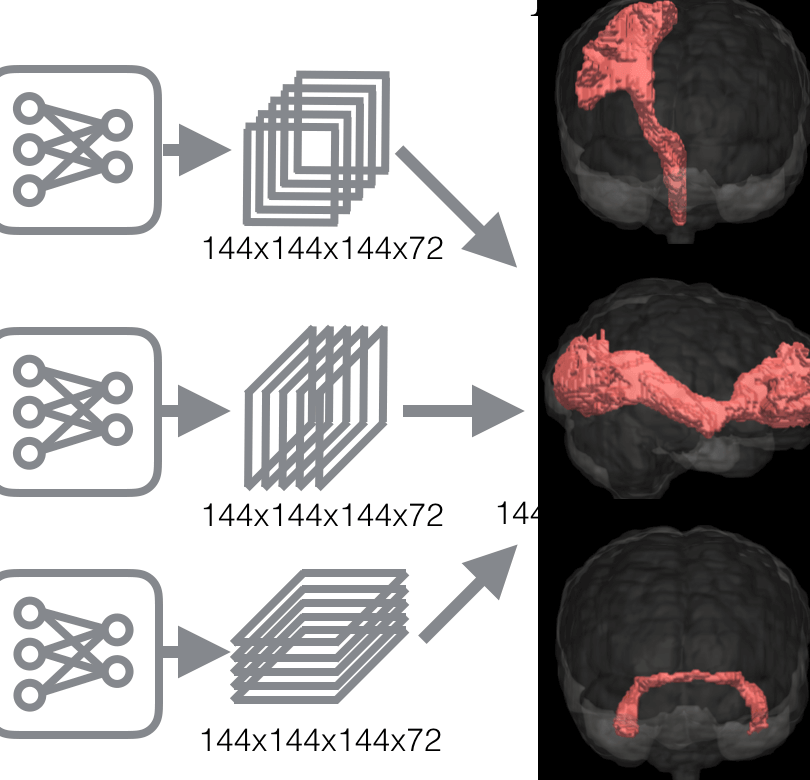

<p align="center">
  
</p>

<h1 align="center">TractSeg</h1>

<p align="center">
  Masks, ending masks, bundle-specific tractograms and tractometry of 72 white matter tracts from diffusion MRI (or precomputed CSD peaks), segmented with TractSeg.
</p>

<p align="center">
  <a href="https://github.com/brainlife/abcd-spec"></a>
  <a href="https://doi.org/10.25663/bl.app.95"></a>
  <a href="https://github.com/brainlife/app-tractseg/blob/master/LICENSE"></a>
</p>

> ⚠️ **This branch, `1.7.3`, is the deprecated brainlife.io App TractSeg** ([doi:10.25663/bl.app.95](https://doi.org/10.25663/bl.app.95)). It is kept so earlier results stay reproducible. Use **TractSeg** ([doi:10.25663/brainlife.app.186](https://doi.org/10.25663/brainlife.app.186)) instead. The other Apps in this repository are listed under **Versions on brainlife.io** below.

## 🧠 At a glance

<!-- brainlife-app:begin (generated from the App manifest; edit the manifest, not this block) -->

> **Brainlife App for MIC-DKFZ/TractSeg. A tool for fast and accurate white matter bundle segmentation from Diffusion MRI using pretrained pytorch ML model.**

| | |
|---|---|
| 📥 **Inputs** | `neuro/dwi` · `neuro/anat/t1w` (optional) |
| 📤 **Outputs** | `neuro/tractmasks` ×2 · `raw` · `neuro/wmc-deprecated` |
| 🐳 **Container** | `brainlife/tractseg:1.7.1` |
| ⚙️ **Resources** | 8 CPUs · 5 h walltime |
| 🔗 **Run it** | [doi.org/10.25663/bl.app.95](https://doi.org/10.25663/bl.app.95) |

#### 📥 Inputs

| Input | Datatype | Required | Description |
|---|---|---|---|
| `dwi` | `neuro/dwi` | yes |  |
| `t1` | `neuro/anat/t1w` | no |  |

#### 📤 Outputs

| Output | Datatype | Description |
|---|---|---|
| `output` | `neuro/tractmasks` |  |
| `raw` | `raw` |  |
| `wmc` | `neuro/wmc-deprecated` |  |
| `endingmasks` | `neuro/tractmasks` |  |

<details>
<summary><b>⚙️ Parameters</b> (2)</summary>

| Parameter | Type | Default | Description |
|---|---|---|---|
| `preprocess` | boolean | `false` | Run preprocessing step to align the input image to MNI. The input image must have the same "orientation" as the Human Connectome Project data (MNI space) (LEFT must be on the same side as LEFT of the HCP data). If the image orientation and the gradient orientation of your data is the same as in examples/Diffusion.nii.gz you are fine. Otherwise you should rigidly register your image to MNI space (the brains do not have to be perfectly aligned but must have the same LEFT/RIGHT orientation). |
| `csd` | enum | `csd` | Choose the type of constrained spherical deconvolution (CSD) to run. If you have a registered T1 and multi-shell data, you can choose csd_msmt_5tt, otherwise choose the default. Options: `csd`, `csd_msmt_5tt`. |

</details>

<!-- brainlife-app:end -->

## 🏷️ Versions on brainlife.io

Each version is a separate App on brainlife.io, built from a branch of this repository. Only App versions 2.2 and later are maintained.

| Version | TractSeg | Branch | Run it | Status |
|---|---|---|---|---|
| TractSeg from peaks | 2.7 | [`2.7`](https://github.com/brainlife/app-tractseg/tree/2.7) | [doi:10.25663/brainlife.app.684](https://doi.org/10.25663/brainlife.app.684) | current |
| TractSeg (from DWI) | 2.7 | [`2.7`](https://github.com/brainlife/app-tractseg/tree/2.7) | [doi:10.25663/brainlife.app.186](https://doi.org/10.25663/brainlife.app.186) | available |
| **TractSeg** (this branch) | 1.7.1 | [`1.7.3`](https://github.com/brainlife/app-tractseg/tree/1.7.3) | [doi:10.25663/bl.app.95](https://doi.org/10.25663/bl.app.95) | deprecated |

Both maintained Apps run the same code: "TractSeg from peaks" starts from a `neuro/peaks` dataset, "TractSeg" computes the CSD peaks from the DWI first.

## About TractSeg

[TractSeg](https://github.com/MIC-DKFZ/TractSeg) is a tool for fast and accurate white matter bundle segmentation from diffusion MRI, developed by Jakob Wasserthal at the Division of Medical Image Computing of the German Cancer Research Center (DKFZ). It uses pretrained 3D fully convolutional neural networks to identify human white matter tracts. See the official repository for details, including the list of bundles.

## 🚀 Running the App

### ☁️ On brainlife.io

Open [TractSeg from peaks](https://doi.org/10.25663/brainlife.app.684) and choose a CSD peaks dataset, or open [TractSeg](https://doi.org/10.25663/brainlife.app.186) and choose a DWI dataset; set the options and press **Execute**. The App runs on a GPU and archives a tractogram, a white matter classification, bundle and ending masks, the full TractSeg output and the tractometry table to your project.

- **Orientation**: the DWI (or peaks) must have the same orientation as the Human Connectome Project data (MNI space): LEFT must be on the same side as LEFT in the HCP data. The brain need not be perfectly aligned to MNI.
- **`csd`** (DWI App only): `csd` (standard CSD, default), `csd_msmt` (multi-shell data required) or `csd_msmt_5tt` (multi-shell data and a T1w image registered to the DWI required).
- **`nr_fibers`**: number of streamlines to create for each bundle (default 2000).
- **`bundles`**: comma-separated list (no spaces) of bundles to track; leave empty to track all.
- **`tractometry_input`**: tractometry is run on the peak length along each tract (`peak_length`).

### 💻 Locally

You need [Singularity/Apptainer](https://apptainer.org/), [`jq`](https://jqlang.github.io/jq/) and an NVIDIA GPU (`main` runs `brainlife/tractseg:2.7` with `--nv`). `main` also uses `brainlife/dipy:1.1.1`, `brainlife/pythonvtk:1.1` and `brainlife/mrtrix3:3.0.0`.

1. Clone this repository and check out the maintained version (`git checkout 2.7`).
2. Create `config.json` with the paths to your inputs and the options you want:

   ```json
   {
       "dwi": "/input/dwi/dwi.nii.gz",
       "bvecs": "/input/dwi/dwi.bvecs",
       "bvals": "/input/dwi/dwi.bvals",
       "preprocess": false,
       "csd": "csd",
       "nr_fibers": 2000,
       "bundles": "",
       "tractometry_input": "peak_length"
   }
   ```

   To start from peaks, replace the DWI keys with `"peaks": "/input/peaks/peaks.nii.gz"`. For `csd_msmt_5tt`, add `"t1": "/input/t1/t1.nii.gz"`.

3. Run the App:

   ```bash
   ./main
   ```

## 📦 Outputs

```text
tck/track.tck                     all bundle-specific (TOM) tractograms merged into one tractogram
wmc/                              white matter classification of the TractSeg bundles, with tracts/ and surfaces/
output/masks/                     binary mask of each bundle (bundle_segmentations)
endingmasks/masks/                binary masks of the start and end regions of each bundle (endings_segmentations)
tractseg_output/                  full TractSeg output: peaks, segmentations, TOM, TOM_trackings, Tractometry_peaks.csv
tractseg_tractometry/tractmeasures.csv   tractometry table (Tractometry_peaks.csv)
```

## 🩺 Troubleshooting

- **`Error: csd_msmt_5tt requires a T1w image.`**: provide the optional T1w input (registered to the DWI) or choose `csd` or `csd_msmt`.
- **`Error: csd_msmt_5tt doesn't work with --preprocess.`**: disable `preprocess` when using `csd_msmt_5tt`. The `preprocess` option is currently disabled on brainlife.io because it produces `peaks.nii.gz` of the wrong size for the later steps; align the data to MNI orientation beforehand instead.
- **Missing or misplaced tracts**: check that the input has the HCP/MNI orientation described above.

## 📚 Citing

> [!TIP]
> If you use this App in your work, please cite the App, the software it builds on and brainlife.io (below). GitHub's **Cite this repository** button gives the App citation in APA and BibTeX.

- Wasserthal J, Neher P, Maier-Hein KH. TractSeg: fast and accurate white matter tract segmentation. *NeuroImage* 183:239–253 (2018). [doi:10.1016/j.neuroimage.2018.07.070](https://doi.org/10.1016/j.neuroimage.2018.07.070)
- TractSeg. brainlife.io App. [doi:10.25663/bl.app.95](https://doi.org/10.25663/bl.app.95)
- Jenkinson et al. FSL. *NeuroImage* 62:782-790 (2012). [doi:10.1016/j.neuroimage.2011.09.015](https://doi.org/10.1016/j.neuroimage.2011.09.015)
- Tournier et al. MRtrix3: A fast, flexible and open software framework for medical image processing and visualisation. *NeuroImage* 202:116137 (2019). [doi:10.1016/j.neuroimage.2019.116137](https://doi.org/10.1016/j.neuroimage.2019.116137)
- Garyfallidis et al. Dipy, a library for the analysis of diffusion MRI data. *Frontiers in Neuroinformatics* 8 (2014). [doi:10.3389/fninf.2014.00008](https://doi.org/10.3389/fninf.2014.00008)
- Hayashi S, Caron BA, Heinsfeld AS, et al. brainlife.io: a decentralized and open-source cloud platform to support neuroscience research. *Nature Methods* 21:809–813 (2024). [doi:10.1038/s41592-024-02237-2](https://doi.org/10.1038/s41592-024-02237-2)
- Avesani P, McPherson B, Hayashi S, et al. The open diffusion data derivatives, brain data upcycling via integrated publishing of derivatives and reproducible open cloud services. *Scientific Data* 6:69 (2019). [doi:10.1038/s41597-019-0073-y](https://doi.org/10.1038/s41597-019-0073-y)

## 👥 Authors

- Soichi Hayashi
- Franco Pestilli (project director)

**Contributors:** Jakob Wasserthal, Lindsey Kitchell, Giulia Bertò, Brad Caron

## 💰 Funding

[](https://wellcome.org/)
[](https://reporter.nih.gov/project-details/11261037)
[](https://reporter.nih.gov/project-details/11411328)
[](https://reporter.nih.gov/project-details/10262925)
[](https://reporter.nih.gov/project-details/10428625)
[](https://reporter.nih.gov/project-details/10460628)
[](https://reporter.nih.gov/project-details/11140284)
[](https://www.nsf.gov/awardsearch/showAward?AWD_ID=1734853)
[](https://www.nsf.gov/awardsearch/showAward?AWD_ID=2203524)
[](https://www.nsf.gov/awardsearch/showAward?AWD_ID=1636893)
[](https://www.nsf.gov/awardsearch/showAward?AWD_ID=2148729)
[](https://www.nsf.gov/awardsearch/showAward?AWD_ID=1912270)
[](https://www.nsf.gov/awardsearch/showAward?AWD_ID=2148700)
[](https://www.nsf.gov/awardsearch/showAward?AWD_ID=1916518)

<sub>brainlife.io is publicly funded, and acknowledging that support helps keep it running. This App was developed with support from Wellcome, the U.S. National Institutes of Health (including the BRAIN Initiative BRAIN CONNECTS program: The Axonal Projectome EXchange, U24NS140384, and the Center for Mesoscale Connectomics, UM1NS132207) and the U.S. National Science Foundation.</sub>

## ⚖️ License

[MIT](https://github.com/brainlife/app-tractseg/blob/master/LICENSE). Copyright brainlife.io, The University of Texas at Austin and Indiana University, German Cancer Research Center (DKFZ), Division of Medical Image Computing (MIC). TractSeg itself is distributed under its own [license](https://github.com/MIC-DKFZ/TractSeg).
